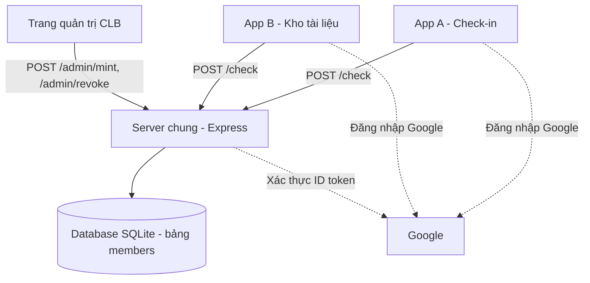
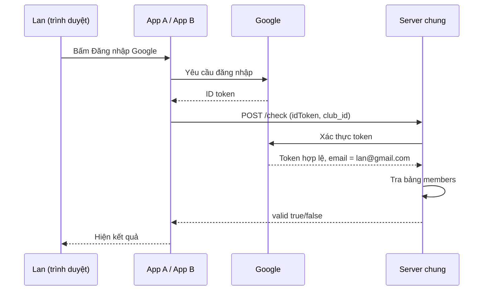

# Thiết kế baseline SSO (Google Login + DB chung)

Người làm: Đỗ Duy Hiếu · Tuần 3 4

## 1. Sơ đồ kiến trúc
 

 
Điểm tập trung cần so sánh: cả App A và App B đều phụ thuộc vào **một** Server chung. Server tắt thì cả hai app không kiểm tra được thẻ. Ở PortablePass, vai trò này do smart contract công khai trên chain đảm nhiệm.
 
## 2. Thiết kế bảng `members`
 
| Cột | Kiểu | Ý nghĩa | Tương ứng bên PortablePass |
|---|---|---|---|
| id | INTEGER | Khóa chính, tự tăng | (không cần) |
| email | TEXT | Email Google của sinh viên | Địa chỉ ví |
| club_id | TEXT | Mã CLB, ví dụ `english-club` | clubId |
| expiry | INTEGER | Hạn dùng, tính bằng giây Unix | expiry |
| revoked | INTEGER | 0 = còn hiệu lực, 1 = đã thu hồi | revoked |
 

 
`UNIQUE (email, club_id)` đảm bảo mỗi cặp (email, CLB) chỉ có một dòng, nên Revoke không bỏ sót dòng nào.
 
Dữ liệu mẫu để kiểm tra thiết kế (giả sử bây giờ là `1800000000`):
 
| id | email | club_id | expiry | revoked | Kết quả khi kiểm tra |
|---|---|---|---|---|---|
| 1 | lan@gmail.com | english-club | 1810000000 | 0 | Hợp lệ |
| 2 | lan@gmail.com | music-club | 1810000000 | 0 | Hợp lệ |
| 3 | nam@gmail.com | english-club | 1790000000 | 0 | Từ chối: hết hạn |
| 4 | an@gmail.com | english-club | 1810000000 | 1 | Từ chối: đã thu hồi |
| (không có dòng) | lan@gmail.com | drama-club | | | Từ chối: chưa có thẻ |
 
Ghi chú quyền riêng tư: baseline lưu `email` (thông tin cá nhân) trong database có người quản trị. PortablePass chỉ lưu địa chỉ ví, không có tên hay MSSV.
 
## 3. Các API
 
### API 1: Cấp thẻ (tương ứng `mint`)
- Đường dẫn: `POST /admin/mint`
- Đầu vào: `email`, `club_id`, `expiry`
- Việc làm: thêm 1 dòng vào `members` với `revoked = 0`. Nếu cặp (email, club_id) đã có thì cập nhật `expiry` và đặt lại `revoked = 0` (cấp lại thẻ).
- Đầu ra: `{ ok: true }`. Thiếu thông tin thì trả lỗi 400.
### API 2: Thu hồi thẻ (tương ứng `revoke`)
- Đường dẫn: `POST /admin/revoke`
- Đầu vào: `email`, `club_id` (xác định đúng một dòng nhờ ràng buộc UNIQUE)
- Việc làm: đặt `revoked = 1` cho dòng đó
- Đầu ra: `{ ok: true }`. Không tìm thấy dòng thì trả lỗi 404.
### API 3: Kiểm tra thẻ (tương ứng `isValid`)
- Đường dẫn: `POST /check`
- Đầu vào: `idToken` (do Google cấp), `club_id`
- Việc làm: server xác thực `idToken`, lấy `email` từ token, rồi tra bảng `members`. Thẻ hợp lệ khi đủ 3 điều kiện:
  1. Có dòng khớp (email, club_id)
  2. `expiry` lớn hơn thời điểm hiện tại
  3. `revoked = 0`
- Đầu ra: `{ valid: true }` hoặc `{ valid: false, reason: "no_card" | "expired" | "revoked" }`
Lưu ý: ở tuần 4 để test nhanh, `/check` tạm nhận thẳng `email` qua tham số (`GET /check?email=...&club=...`). Bản này **không an toàn** vì ai cũng có thể điền email người khác (giống việc giả danh địa chỉ ví không có chữ ký). Tuần 5 sẽ đổi sang `idToken`.
 
### Bảo mật API admin
`/admin/...` chỉ ban chủ nhiệm CLB được gọi. Tuần 3 chỉ ghi chú yêu cầu "cần xác thực quản trị", cách làm cụ thể (ví dụ khóa API đơn giản) quyết định ở tuần 5.
 
## 4. Luồng đăng nhập Google
 
1. Sinh viên bấm **Đăng nhập bằng Google** trên App.
2. Google xác nhận danh tính và trả về cho App một **ID token** (giấy có chữ ký của Google, ghi "người này là lan@gmail.com").
3. App gửi `idToken` và `club_id` lên Server (`POST /check`).
4. Server kiểm tra token là thật và lấy ra `email`.
5. Server tra bảng `members` theo (email, club_id) và trả về hợp lệ hay không.

 
So sánh với PortablePass: bước 2-4 thay cho "ký nonce". Ở Pass người dùng chứng minh mình là chủ ví bằng chữ ký; ở baseline chứng minh mình là chủ email bằng Google.
 
## 5. Kịch bản 6 bước bản baseline
 
| Bước | PortablePass | Baseline |
|---|---|---|
| 1 | CLB nhập ví của Lan, bấm Mint | CLB nhập **email** của Lan, gọi `POST /admin/mint` |
| 2 | Lan vào App A, bấm Connect Wallet | Lan vào App A, bấm **Đăng nhập Google** |
| 3 | App A gửi nonce, Lan ký | App A nhận ID token từ Google và gửi lên Server |
| 4 | App A hỏi contract `isValid` | App A gọi `POST /check` → "Check-in thành công" |
| 5 | Lan vào App B, làm tương tự, hiện nút Tải slide PDF | Lan vào App B, đăng nhập Google, App B gọi `POST /check` lên **cùng Server** → hiện nút Tải slide PDF |
| 6 | CLB bấm Revoke, cả hai app từ chối; chuyển thẻ sang ví khác thất bại | CLB gọi `POST /admin/revoke`; Lan thử lại ở App A và B, cả hai gọi `/check` và nhận `revoked` → từ chối. (Không có khái niệm chuyển thẻ vì thẻ gắn với email, nhưng vẫn cần kiểm tra không ai dùng email người khác khi không có token hợp lệ.) |
 
## 6. Kế hoạch đo (dùng ở tuần 9)
 
### 6.1 Công sức tích hợp một app mới (App C)
 
| | Baseline | PortablePass |
|---|---|---|
| Các bước cần làm | 1. Xin quyền gọi Server chung (xin URL, khóa API) 2. Đăng ký Google Client ID cho App C 3. Thêm nút đăng nhập Google 4. Gửi `idToken` lên `POST /check` 5. Xử lý kết quả `valid` / `reason` | *(điền sau khi nhận ABI ở tuần 5)* |
| Số bước | 5 | ? |
| Số dòng code | đo ở tuần 9 | đo ở tuần 9 |
| Thời gian làm | đo ở tuần 9 | đo ở tuần 9 |
 
### 6.2 Tình huống một bên ngừng hoạt động
 
1. Bật cả hai phương án, xác nhận App A và B đều check-in được.
2. **Baseline:** tắt Server (dừng `node server.js`) → thử đăng nhập và kiểm tra ở App A, B → ghi kết quả (dự kiến: cả hai đều thất bại).
3. **PortablePass:** tắt Issuer App → thử check-in ở App A, B → ghi kết quả (dự kiến: vẫn kiểm tra được vì chỉ cần đọc chain).
Điều cần chứng minh: khi bên cấp thẻ hoặc server ngừng, PortablePass vẫn xác minh được thẻ đã cấp.

## 7. Giao diện App B (4 trạng thái)
 
Khung chung: tiêu đề **"Kho tài liệu CLB"** ở trên cùng, nội dung ở giữa.
 
### Trạng thái 1: Chưa kết nối
```
+--------------------------------------+
|        Kho tài liệu CLB              |
|                                      |
|  Hãy kết nối ví để xem tài liệu      |
|                                      |
|        [  Connect Wallet  ]          |
+--------------------------------------+
```
 
### Trạng thái 2: Đang xác minh
```
+--------------------------------------+
|        Kho tài liệu CLB              |
|                                      |
|  Hãy mở ví và ký xác nhận            |
|            ( ... đang chờ ... )      |
+--------------------------------------+
```
 
### Trạng thái 3: Hợp lệ
```
+--------------------------------------+
|        Kho tài liệu CLB              |
|                                      |
|  Chào mừng thành viên CLB Tiếng Anh  |
|                                      |
|        [  Tải slide PDF  ]           |
+--------------------------------------+
```
 
### Trạng thái 4: Bị từ chối (3 biến thể)
```
+--------------------------------------+
|        Kho tài liệu CLB              |
|                                      |
|  Ví này chưa có thẻ thành viên       |
|   (hoặc: Thẻ đã hết hạn)             |
|   (hoặc: Thẻ đã bị thu hồi)          |
|                                      |
|           [  Thử lại  ]              |
+--------------------------------------+
```
 
Mỗi trạng thái tương ứng một nhánh `if` trong code ở tuần 6.
